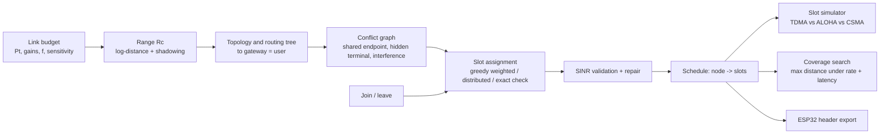

# TDMA Schedule and Topology Optimizer

Full results report: [docs/EVO3_REPORT.md](docs/EVO3_REPORT.md)

Stage 1 was a 4x4 TDMA schedule planner (Python "brain", EMANE emulation, MATLAB and ns-3 slot simulations).
Stage 2 scales it to **N radios**, adds a physical radio model, and answers: *how far from the user can the
network reach while still meeting a throughput and latency target?*



## Run it (Ubuntu / WSL2)
```bash
python3 -m venv .venv && source .venv/bin/activate
make setup      # numpy, matplotlib, pytest
make test       # full regression suite
make demo       # 12-radio walkthrough in the terminal
make all        # tests + all experiments + docs/RESULTS.md
make graphs N=18   # graph-theory figures for any number of radios
```

## What is in it
| module | what it does |
|---|---|
| `tdmaopt/phy.py` | link budget, range, log-normal shadowing, `disk` and `sinr` reception rules |
| `tdmaopt/topology.py` | random / chain / grid topologies, BFS routing tree, coverage radius |
| `tdmaopt/schedule.py` | conflict graph, weighted greedy scheduler, distributed scheduler, exact solver, SINR repair |
| `tdmaopt/sim.py` | slotted simulator for TDMA, ALOHA, CSMA (convergecast to the gateway) |
| `tdmaopt/dynamic.py` | incremental re-scheduling when a node joins or leaves |
| `tdmaopt/coverage.py` | chain study and maximum coverage distance under rate and latency limits |
| `tdmaopt/viz.py` | topology graph, conflict graph + colouring, frame timeline, arrangement patterns, Pareto search |
| `tdmaopt/export.py` | C header for the ESP32 demo |
| `experiments/` | one script per result in `docs/RESULTS.md` |

## Algorithms
* **Conflict graph.** Each node owns one uplink (node -> parent). Two uplinks cannot share a slot if they share an
  endpoint (half duplex or same receiver), or if one transmitter jams the other's receiver (hidden terminal / interference).
* **Weighted greedy colouring.** Each node needs as many slots per frame as packets it must send (its own plus everything
  it forwards). Heaviest nodes are placed first. Terminates after N assignments. Guaranteed frame length
  `F <= max_i(d_i + sum of neighbours' d_j)`; for unit demand `F <= Delta + 1`.
* **Distributed variant.** Each pending node picks a random slot from a palette of `Delta + 1` that none of its settled
  conflict neighbours uses; clashes are broken by node id. Converges in a few rounds because the palette cannot run out.
* **SINR repair.** A schedule built on pairwise conflicts can still fail when many weak interferers add up. Failing
  transmissions are moved one at a time to a slot where they work and break nobody; every move lowers the failure count,
  so the loop converges.
* **Coverage search.** Add relays along a chain at 0.9 x Rc and stop when the frame can no longer carry the required
  per-node rate or the worst-case latency (`hops x frame`) exceeds the budget.

## Honest limitations
* The gateway receives one packet per slot, so when every node reports, frame length grows roughly linearly with N.
  That is physics of a single sink, not a flaw of the scheduler. For a single flow, spatial reuse keeps the frame at 3 slots for any chain length.
* Greedy is not optimal in general (optimal colouring is NP-hard). The exact-solver experiment shows where it is optimal
  and where it loses a slot.
* Conflict graph construction is O(N^2). Fine to a few hundred nodes; a spatial index would be needed beyond that.
* The simulator is slot-level: no clock drift, no preamble or ACK timing, no capture effect beyond the SINR threshold.
* `esp32/tdma_node/tdma_node.ino` is an untested skeleton. Test on real boards before quoting results from it.
* Latency in `coverage` is a conservative worst-case bound, not a measured value.

## Results
See `docs/RESULTS.md` (generated) and the plots in `results/`.

## Rank every topology for N radios of range R

    python3 -m tdmaopt.analyze --n 18 --range 100 --distance 800 --users 40
    make analyze N=18 R=100 ARGS="--distance 800 --users 40"

Inputs: `--n` radios, `--range` metres, `--distance` required reach, `--users` attached users.
Outputs in `results/`: `analysis_n*_r*.md/.json/.png/_best.png`.

## Radios with different ranges (the optimizer)

    python3 -m tdmaopt.hetero                       # asks: total number of radios, then the effective coverage (metres)
    python3 -m tdmaopt.hetero --n 85 --coverage 800 # 85 radios, 800 m each (one value = all radios; or one value per radio)
    python3 -m tdmaopt.hetero --coverage 500,300,300,200 --distance 900   # optional: required distance from your radio

You give the number of radios and their effective coverage. The program builds every topology (chain, ring, spiders,
trees, comb, plus a free-form searched layout), rejects those that break the spacing rule, and sorts the rest for the best case.
Model settings (`--min-sep 0.5 --link-margin 0.9 --interference 1.5`) are printed in the report and can be changed.
Outputs: `results/opt_n*.md/.json/_layout.csv/_best.png/_compare.png`.

## Paper (theory + reproducible results)
`make paper` regenerates every figure/table in `results/paper/` and compiles `paper/main.tex`
(IEEEtran is used automatically if installed; otherwise an article-class fallback).


## Evolution 3: Adaptive and Operational Enhancements

Validation date: 10 November 2026

Evolution 3 adds eight advancements:

1. Adaptive TDMA scheduling using live telemetry.
2. Multi-hop routing and gateway forwarding.
3. Rayleigh and Rician PHY fading integrated into SINR.
4. Predictive adaptation using four EMANE measurement windows.
5. Self-healing alternate-route selection after simulated link failure.
6. Distributed slot coordination and lease validation.
7. Schedule-aware energy estimation.
8. Clock synchronization simulation and guard-time estimation.

### Experimental results

Measured on EMANE with 12 radios, and modelled results, are in [docs/EVO3_REPORT.md](docs/EVO3_REPORT.md).
The authoritative run is `results/evo3-full-20261111-082053`. Earlier runs in `results/` are kept as history.

### Testing

The complete project regression suite passed 71 tests.

Run tests using:

    .venv/bin/python -m pytest -q

### Validation limitations

- Energy savings are modeled using assumed power values.
- Clock synchronization was simulated, not measured on hardware.
- Predictive adaptation uses four measurement windows.
- Queue demand values are topology-based estimates.


## Evolution 3 full pipeline: n radios, coverage d, best-case scheduler, live EMANE

    bash emane/evo3_host.sh        # asks for number of radios and coverage, then runs everything
    python3 emane/evo3_full.py offline --plan results/opt_n12.json --out results/evo3-offline

Live EMANE results (12 radios, mean and range over 4 runs, details in [docs/EVO3_REPEATS.md](docs/EVO3_REPEATS.md)):

| Experiment | Result |
|---|---|
| Multi-hop convergecast, up to 4 hops | 99.98% (99.92 to 100) |
| Forced slot collision | 92.94% (90.05 to 94.29) |
| Optimized schedule restored | 99.78% (99.67 to 99.84) |
| Adaptive rescheduling, surged radio | 75.81% to 100% (100% in all runs) |
| Relay-failure recovery (self-healing) | 79.82% during failure, 99.94% after recovery |

SINR/fading, energy, clock sync, distributed scheduling and prediction are modelled in simulation, not measured on hardware.
Above 30 radios the pipeline runs offline only, because one laptop cannot emulate more accurately.
Full report: `results/evo3-full-20261111-082053/EVO3_FULL_REPORT.md`.
