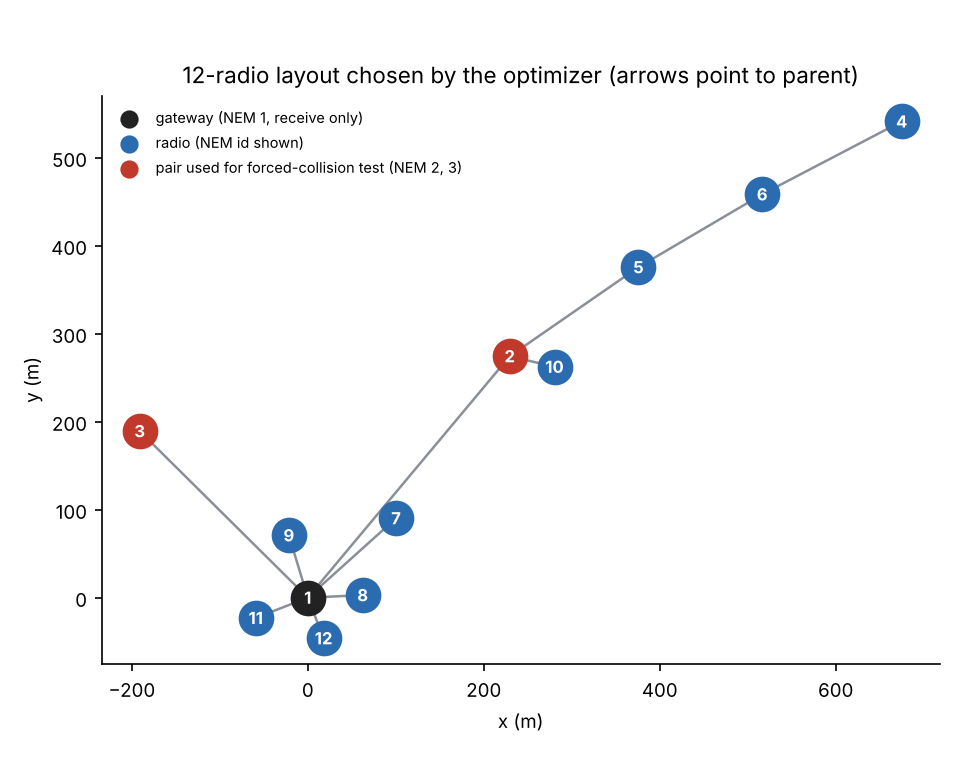
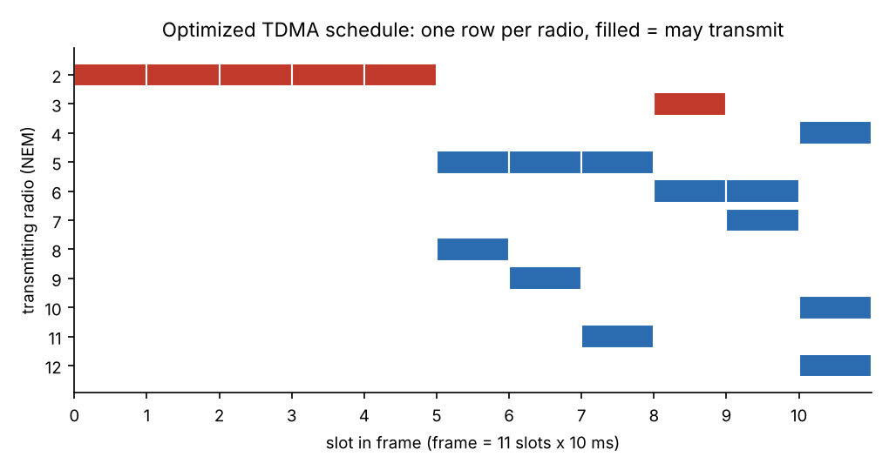
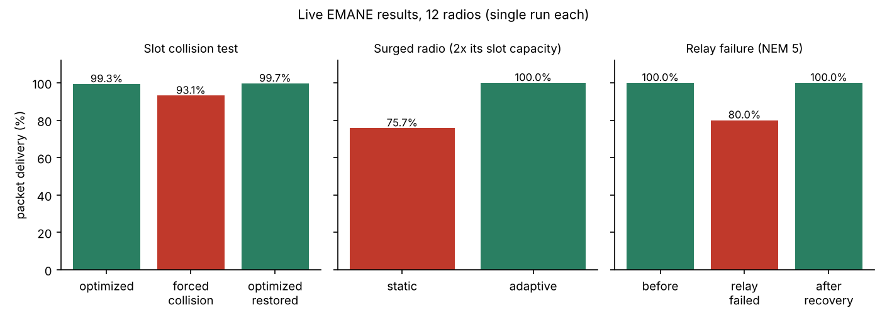
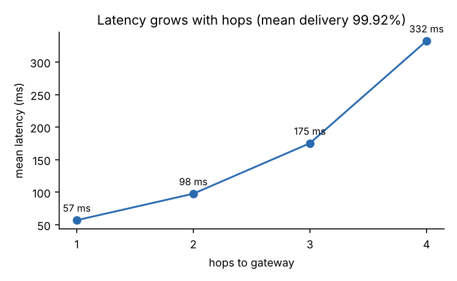
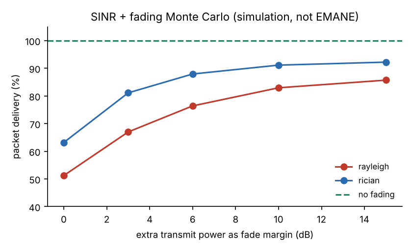

# TDMA Schedule and Topology Optimizer: Evolution 3 Report

**Author:** Sudarshan V, College of Engineering, Guindy · **Run:** `results/evo3-full-20261111-082053` · **Branch:** `evolution-3-complete`

This report explains what the project does, how it was tested on the EMANE network emulator with 12 radios, and what the results do and do not prove. Every number below comes from the files in the run folder. The figures are regenerated from those files by `scripts/make_evo3_figures.py`.

## 1. What the project does

You give the program two numbers: **how many radios** and **how far each one covers**. It then:

1. Builds candidate layouts (chains, rings, spiders, combs, trees and a searched free-form layout) and rejects those that break the spacing rule.
2. Picks the best layout and routes every radio's traffic to one **gateway**.
3. Produces a **collision-free TDMA schedule**: a repeating frame of 10 ms slots, with each radio told in which slots it may transmit.
4. Exports that schedule to the EMANE emulator and tests it with real traffic between 12 emulated radios.

The program never assumes the number of radios or the coverage. It asks (`bash emane/evo3_host.sh`).

## 2. The layout and schedule that were tested



Radio 1 (NEM 1) is the gateway and only receives. The farthest radio (NEM 4) is **4 hops** away. The frame is **11 slots** (110 ms).



NEM 2 carries the traffic of its subtree (NEM 5, 6, 4 and 10), so it owns 5 of the 11 slots. Radios whose slots do not overlap can talk at the same time only if the conflict graph says they cannot interfere.

**How the slots are chosen.** Radios that interfere cannot share a slot, which is the same as colouring a graph so that neighbours get different colours. The scheduler tries several colouring orders and keeps the shortest frame. One of them is *maximum cardinality search* (`mcs_order` in `tdmaopt/schedule.py`). On chain and spider layouts the conflict graph is chordal, and for those graphs this order gives a provably minimum frame.

## 3. Results measured on EMANE (12 radios)



Each experiment ran once. There are no repeats yet, so there are no error bars.

| Experiment | Result | What it shows |
|---|---|---|
| Multi-hop convergecast, 4 windows of 976 packets each | **99.92 %** mean (sd 0.10) | The schedule delivers traffic over up to 4 hops |
| Forced slot collision (NEM 2 and 3 share a slot) | 99.35 % → **93.15 %** | NEM 2 lost 13.8 %, NEM 3 lost 50 % on their links |
| Optimized schedule restored | **99.67 %** | The optimizer's schedule removes the collision |
| Surged radio (NEM 3 at 2× its slot capacity) | **75.74 % → 100 %** | Adaptive rescheduling gave it 3 slots instead of 1 |
| Network delivery during that surge | 78.82 % → 99.92 % | The whole network recovers, not just one radio |
| Relay NEM 5 stopped | 100 % → **80 %** → **100 %** | Orphaned radio NEM 6 was moved to parent NEM 2, and delivery recovered |



Mean latency was 57, 98, 175 and 332 ms for 1, 2, 3 and 4 hops. With a 110 ms frame, each extra hop costs roughly one frame, as expected from TDMA.

## 4. The eight advancements and how each was tested

| # | Advancement | How it was tested | Result |
|---|---|---|---|
| 1 | Adaptive scheduling | **Measured on EMANE** | See section 3 |
| 2 | Multi-hop routing (Dijkstra) | **Measured on EMANE** | 99.92 % over up to 4 hops |
| 3 | SINR and fading | Monte Carlo **simulation** | Section 5 |
| 4 | Predictive adaptation | **Measured on EMANE**, walk-forward forecast | Section 6 |
| 5 | Self-healing | **Measured on EMANE**, relay process stopped | 80 % → 100 % |
| 6 | Distributed scheduling | Local negotiation **simulation**, not real radio messages | Frame 13 vs 11 (+18.2 %), 0 conflicts |
| 7 | Energy-aware scheduling | **Model** with assumed power values | 67.25 % lower energy per frame |
| 8 | Clock synchronisation | **Simulation** with assumed 20 ppm drift | Guard time 32 µs, 0.32 % of a slot |

## 5. SINR and fading (simulation only)



EMANE here uses a binary path-loss model (80 dB inside range, 200 dB outside), so it cannot show fading. The Monte Carlo study therefore shows what would happen on a real channel. Without fading the schedule is SINR-safe (100 %). Under Rayleigh fading delivery falls to 51 % with no margin and recovers to 86 % with 15 dB of extra power. Under Rician fading it falls to 63 % and recovers to 92 %. This shows the schedule is correct but a real channel needs link margin.

## 6. Honest limitations

* **One run per experiment.** The 12-radio results are single measurements. Repeating them 3 times and reporting the range is the next step.
* **Only 12 radios were emulated.** One WSL2 laptop cannot emulate 100 radios accurately (a 100-radio attempt delivered about 39 %, which reflects the laptop, not the schedule). Above 30 radios the pipeline runs offline only.
* **The predictive forecast was no better than a simple baseline.** Forecast error was 0.00039 against 0.00033 for "repeat the last window". With delivery near 100 % there was nothing to predict, so this result is not evidence that prediction helps.
* **Self-healing needs spare coverage.** The best-case layout is a sparse tree with no backup parents. 0 of 3 relays could be recovered at the design coverage. The live test used a layout with coverage ×1.75 (frame 13, recovering to frame 10), and relay NEM 2 could not be recovered even at ×3.
* **Adaptive frame length.** After the surge the frame stayed at 11. The best-case scheduler gives 9 slots for the same demand, so the adaptive step is not yet as tight as a full re-optimization.
* **Energy, clock sync and fading are models.** They use assumed values and were not measured on hardware.
* **Distributed scheduling costs frame length** (13 vs 11 slots) compared with the central optimizer.
* **The ESP32 node code is an untested skeleton.**

## 7. Reproduce it

```bash
# whole pipeline: asks for number of radios and coverage, then runs EMANE in Docker
bash emane/evo3_host.sh

# offline-only stages (no EMANE needed)
python3 emane/evo3_full.py offline --plan results/opt_n12.json --out results/evo3-offline

# regenerate the figures in this report
python3 scripts/make_evo3_figures.py results/evo3-full-20261111-082053 docs/img

# tests
python3 -m pytest -q
```

## 8. Where the evidence is

| File in `results/evo3-full-20261111-082053/` | Contents |
|---|---|
| `EVO3_FULL_REPORT.md`, `evo3_full_report.json` | Machine-written summary of every stage |
| `baseline-evidence/` | Per-link delivery for the good, forced-collision and restored schedules |
| `base*_sink.json` | The four multi-hop measurement windows |
| `surge_static_sink.json`, `surge_adaptive_sink.json` | Surge test before and after adaptation |
| `heal_*_sink.json`, `schedule_healed.xml` | Relay-failure test |
| `cfg/`, `cfg_resilient/` | EMANE configuration for both layouts |
| `logs/` | One log per emulated process |

## 9. Glossary

* **TDMA:** radios take turns, each transmitting only in its own time slots.
* **EMANE:** a network emulator that runs real software on virtual radios with a modelled channel.
* **NEM:** one emulated radio in EMANE. Here, NEM *k* is radio *k − 1* in the optimizer.
* **Convergecast:** all traffic flows to a single gateway.
* **Packet delivery (PDR):** packets received divided by packets sent.
* **SINR:** signal power divided by interference plus noise.
