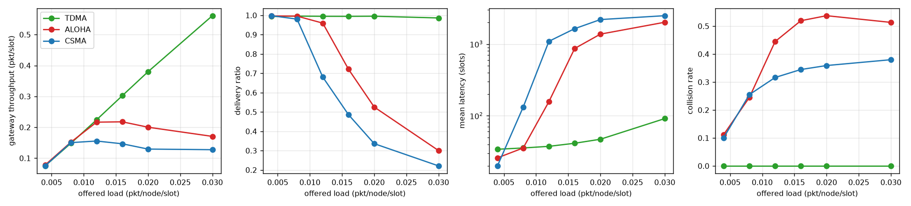
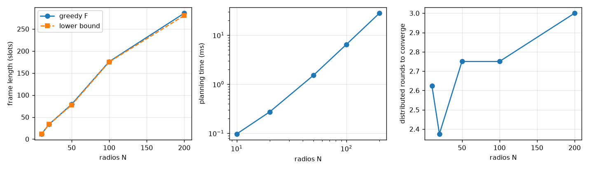
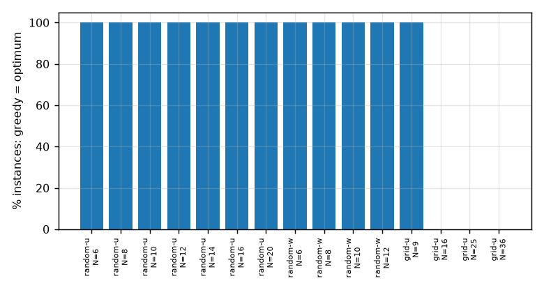
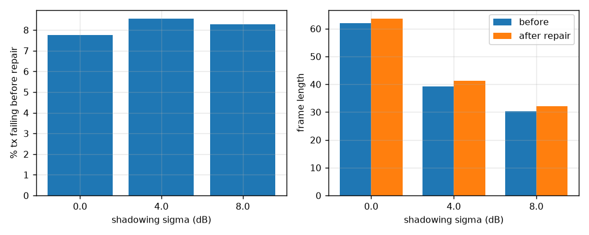
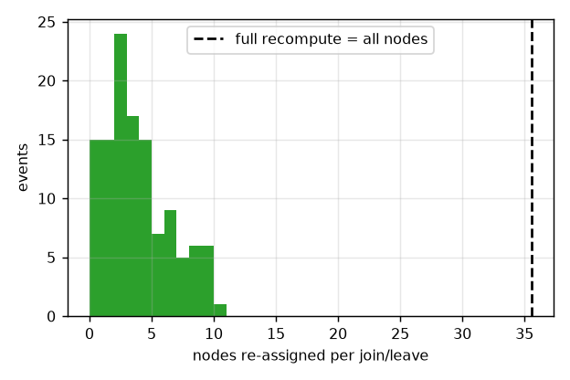
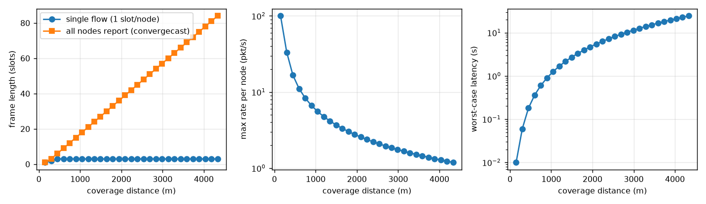

# Results (auto-generated by `make report` - every number comes from `results/*.json`)

## 1. Baselines

N = 20 radios, 5 random topologies, 8000 simulated slots per run.

**Collisions with the same frame length** (random slot choice vs the planner): 65.9% vs 0.0% of transmissions.

| load (pkt/node/slot) | protocol | gateway throughput (pkt/slot) | delivered | collisions | mean latency (slots) | tx per delivered packet |
|---|---|---|---|---|---|---|
| 0.004 | TDMA | 0.075 | 99.4% | 0.0% | 34.1 | 2.25 |
| 0.004 | ALOHA | 0.078 | 99.6% | 11.2% | 25.9 | 2.56 |
| 0.004 | CSMA | 0.075 | 99.8% | 10.1% | 20.0 | 2.51 |
| 0.008 | TDMA | 0.148 | 99.6% | 0.0% | 35.5 | 2.26 |
| 0.008 | ALOHA | 0.152 | 99.6% | 24.5% | 35.5 | 3.01 |
| 0.008 | CSMA | 0.150 | 98.0% | 25.5% | 132.0 | 3.05 |
| 0.012 | TDMA | 0.224 | 99.5% | 0.0% | 37.4 | 2.26 |
| 0.012 | ALOHA | 0.217 | 96.0% | 44.5% | 157.4 | 4.43 |
| 0.012 | CSMA | 0.156 | 68.1% | 31.6% | 1092.8 | 4.16 |
| 0.016 | TDMA | 0.302 | 99.5% | 0.0% | 41.3 | 2.25 |
| 0.016 | ALOHA | 0.218 | 72.1% | 51.9% | 867.2 | 5.73 |
| 0.016 | CSMA | 0.147 | 48.6% | 34.5% | 1639.0 | 5.32 |
| 0.02 | TDMA | 0.380 | 99.5% | 0.0% | 47.0 | 2.25 |
| 0.02 | ALOHA | 0.200 | 52.5% | 53.7% | 1375.1 | 7.22 |
| 0.02 | CSMA | 0.129 | 33.6% | 35.9% | 2196.1 | 6.95 |
| 0.03 | TDMA | 0.561 | 98.6% | 0.0% | 91.3 | 2.25 |
| 0.03 | ALOHA | 0.171 | 30.0% | 51.3% | 2014.2 | 9.14 |
| 0.03 | CSMA | 0.127 | 22.1% | 38.0% | 2486.5 | 8.52 |

## 2. Scaling

| N | frame length | lower bound | F / LB | planning time (ms) | spatial reuse | distributed rounds | conflict-free |
|---|---|---|---|---|---|---|---|
| 10 | 11.9 | 11.9 | 1.000 | 0.10 | 1.18 | 2.6 | True |
| 20 | 33.6 | 33.6 | 1.000 | 0.27 | 1.43 | 2.4 | True |
| 50 | 79.0 | 77.5 | 1.019 | 1.52 | 2.21 | 2.8 | True |
| 100 | 176.0 | 175.1 | 1.007 | 6.49 | 3.08 | 2.8 | True |
| 200 | 285.9 | 280.8 | 1.018 | 28.10 | 4.03 | 3.0 | True |

## 3. Greedy vs exact optimum

| family | N | instances | proven optimal | greedy = optimum | greedy = clique bound | max gap (slots) |
|---|---|---|---|---|---|---|
| random, unit demand | 6 | 30 | 30 | 100% | 100% | 0 |
| random, unit demand | 8 | 30 | 30 | 100% | 100% | 0 |
| random, unit demand | 10 | 30 | 30 | 100% | 100% | 0 |
| random, unit demand | 12 | 30 | 30 | 100% | 100% | 0 |
| random, unit demand | 14 | 30 | 30 | 100% | 100% | 0 |
| random, unit demand | 16 | 30 | 30 | 100% | 93% | 0 |
| random, unit demand | 20 | 30 | 30 | 100% | 97% | 0 |
| random, weighted demand | 6 | 30 | 30 | 100% | 100% | 0 |
| random, weighted demand | 8 | 30 | 30 | 100% | 100% | 0 |
| random, weighted demand | 10 | 30 | 30 | 100% | 100% | 0 |
| random, weighted demand | 12 | 30 | 30 | 100% | 100% | 0 |
| grid, unit demand | 9 | 1 | 1 | 100% | 100% | 0 |
| grid, unit demand | 16 | 1 | 1 | 0% | 0% | 1 |
| grid, unit demand | 25 | 1 | 1 | 0% | 0% | 1 |
| grid, unit demand | 36 | 1 | 1 | 0% | 0% | 1 |

On random trees the frame length is set by the gateway (it can receive one packet per slot), which the clique lower bound captures, so greedy reaches the optimum. On grids greedy loses one slot.

## 4. Realistic interference (SINR + shadowing)

| shadowing sigma (dB) | tx failing before repair | frame before | frame after | repair iterations | failures after |
|---|---|---|---|---|---|
| 0.0 | 7.8% | 61.9 | 63.6 | 5.6 | 0 |
| 4.0 | 8.5% | 39.2 | 41.3 | 4.3 | 0 |
| 8.0 | 8.3% | 30.3 | 32.1 | 3.8 | 0 |

## 5. Dynamic join / leave

120 events: schedule valid after every event = **True**. Nodes re-assigned per event: mean 3.4, max 10 (network size about 36, so 9.5% on average, instead of 100%).

## 6. Coverage distance from the user

Chain of relays at 0.9 x Rc spacing, 10.0 ms slots.

| relays + gateway | coverage (m) | frame, single flow | frame, all nodes report | max rate per node (pkt/s) | worst latency (s) |
|---|---|---|---|---|---|
| 2 | 149 | 1 | 1 | 100.000 | 0.0 |
| 6 | 747 | 3 | 12 | 8.333 | 0.6 |
| 10 | 1345 | 3 | 24 | 4.167 | 2.2 |
| 14 | 1943 | 3 | 36 | 2.778 | 4.7 |
| 18 | 2540 | 3 | 48 | 2.083 | 8.2 |
| 22 | 3138 | 3 | 60 | 1.667 | 12.6 |
| 26 | 3736 | 3 | 72 | 1.389 | 18.0 |
| 30 | 4334 | 3 | 84 | 1.190 | 24.4 |

**Maximum coverage under a service requirement:**

| latency budget | rate per node | hops | coverage (m) | frame (slots) |
|---|---|---|---|---|
| 5 s | 1.0 pkt/s | 13 | 1943 | 36 |
| 10 s | 0.5 pkt/s | 18 | 2690 | 51 |
| 20 s | 0.2 pkt/s | 26 | 3885 | 75 |
| 60 s | 0.1 pkt/s | 45 | 6725 | 132 |

